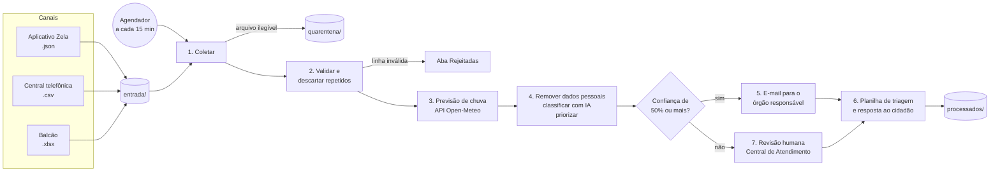

# Zela Robô: triagem automática da zeladoria urbana

Global Solution 2026.2, FIAP, Tecnologia em Inteligência Artificial (2TIAPR).
Disciplina: **AI for Robotic Process Automation (RPA + IA)**.
Parte do projeto integrado **Zela: zeladoria urbana com IA**. O aplicativo do cidadão (React) foi entregue na disciplina de Front End & Mobile Development; este pacote roda sozinho, sem ele.

## Integrantes

| Nome completo | RM |
| --- | --- |
| _preencher_ | _preencher_ |
| _preencher_ | _preencher_ |
| _preencher_ | _preencher_ |

## O problema

No aplicativo Zela, o cidadão descreve com as próprias palavras um problema de zeladoria (buraco, poste apagado, bueiro sem tampa). Mas o pedido não se resolve sozinho depois de registrado. Na prefeitura, alguém precisa:

1. juntar os pedidos que chegam por canais diferentes (aplicativo, central telefônica, balcão), cada um em um formato;
2. ler um por um, decidir de qual órgão é e qual é a urgência;
3. copiar para a planilha de cada órgão e avisar por e-mail.

Esse trabalho é manual e repetitivo. Enquanto ele não é feito, um fio solto perto de uma creche espera na mesma fila de um pedido de capina, e um pedido enviado ao órgão errado volta e espera de novo.

**Público afetado:** moradores de áreas urbanas que dependem da zeladoria pública, em especial idosos, pessoas com deficiência e pessoas com pouca familiaridade digital (o mesmo público do aplicativo). Quem opera o robô é a equipe da Central de Atendimento da prefeitura.

## A solução

O Zela Robô faz esse trabalho de ponta a ponta, sem intervenção: lê a pasta de entrada, valida, remove dados pessoais, classifica com IA, define a prioridade, grava as planilhas, avisa cada órgão por e-mail e devolve a resposta para o cidadão. O que a IA não sabe resolver vai para uma fila de revisão humana.

**Entrada do cidadão → processamento inteligente → resposta e ação.**



Órgãos, prazos e e-mails são ilustrativos (prefeitura fictícia). Nenhum pedido é enviado a um órgão real.

## Como executar

Requer Python 3.10 ou superior. Não precisa de nenhuma chave de API.

```bash
cd zela-robo
python -m venv .venv
.venv\Scripts\activate            # Windows (Prompt de Comando ou PowerShell)
# source .venv/Scripts/activate   # Windows (Git Bash)
# source .venv/bin/activate       # Linux / macOS
python -m pip install -r requirements.txt

python main.py --demo             # copia os arquivos de exemplo para entrada/ e executa tudo
```

O resultado aparece em `saida/<data-hora>/`:

| Arquivo | Conteúdo |
| --- | --- |
| `triagem_<data-hora>.xlsx` | Abas Resumo, Encaminhados, Revisão humana, Rejeitadas e Execução |
| `pedidos_<órgão>_<data-hora>.xlsx` | A planilha de cada órgão (vai em anexo no e-mail) |
| `emails/*.eml` | Os e-mails gerados (abra com um clique duplo) |
| `respostas_cidadao.json` | A resposta em linguagem simples para cada protocolo |
| `relatorio_execucao.json` | Relatório da execução: contagens, falhas tratadas, tempo de cada tarefa |

O log de auditoria fica em `logs/robo.log`.

Outros comandos:

```bash
python main.py                    # processa o que estiver em entrada/
python main.py --agendar          # fica rodando: executa a cada 15 minutos
python main.py --agendar --horario 08:00
python main.py --avaliar          # mede a IA no conjunto de teste rotulado
python -m pytest -q               # 25 testes automatizados, incluindo os casos de falha
python scripts/gerar_dados.py     # recria os dados sintéticos de treino
```

Para usar com dados próprios, coloque arquivos `.json`, `.csv` ou `.xlsx` em `entrada/`. A única coluna obrigatória é o relato (aceita os nomes `relato`, `descricao`, `texto`, `reclamacao`). `bairro`, `referencia`, `protocolo` e `data` são opcionais.

### Como configurar as chaves

O robô roda sem nenhuma chave. A única senha que ele pode usar é a do e-mail, e só se o envio real for ligado:

1. Copie `.env.example` para `.env` (o `.env` está no `.gitignore` e não vai para o repositório).
2. Para enviar e-mails de verdade pelo Gmail, crie uma senha de app em `myaccount.google.com/apppasswords` e preencha:

```
ZELA_EMAIL_MODO=smtp
ZELA_SMTP_USUARIO=seu.email@gmail.com
ZELA_SMTP_SENHA=senha-de-app-de-16-letras
ZELA_EMAIL_DESTINO_TESTE=seu.email@gmail.com
```

Com `ZELA_EMAIL_DESTINO_TESTE`, todos os e-mails vão para a sua própria caixa, porque os endereços dos órgãos são fictícios. Sem o `.env`, vale o modo `arquivo`: os e-mails são gravados como `.eml` e nada é enviado.

### Agendamento em produção

`python main.py --agendar` usa a biblioteca `schedule` e serve para a demonstração. Em um servidor, o agendador do sistema é mais seguro, porque continua valendo depois de reiniciar a máquina:

```bash
# Linux (crontab -e): a cada 15 minutos, das 7h às 19h, de segunda a sexta
*/15 7-19 * * 1-5 cd /caminho/zela-robo && .venv/bin/python main.py

# Windows (Agendador de Tarefas): a cada 15 minutos
schtasks /Create /SC MINUTE /MO 15 /TN ZelaRobo /TR "C:\caminho\zela-robo\.venv\Scripts\python.exe C:\caminho\zela-robo\main.py"
```

Se uma execução ainda estiver rodando quando a próxima começar, a segunda é cancelada pela trava (`saida/robo.lock`).

## Quadro de temas

Sete temas da disciplina, cada um com uma função no fluxo.

| # | Tema da disciplina | Onde entra no fluxo | O que resolve | Por que foi escolhido |
| --- | --- | --- | --- | --- |
| 1 | **Processos, tarefas e BPM** (aula 02) | Desenho do processo (diagrama acima) e `zela_robo/pipeline.py`: 7 tarefas em sequência, cada uma com responsável (robô ou pessoa) e tempo de ciclo medido | Transforma a rotina manual da central em um processo com começo, meio e fim, e mostra onde está o gargalo | Sem mapear o processo, o robô automatizaria passos soltos. A tabela de tarefas sai em cada execução (aba Execução) |
| 2 | **Leitura e manipulação de arquivos** (aula "Leitura de arquivos") | `zela_robo/ingestao.py`: lê `.json`, `.csv` e `.xlsx` da pasta `entrada/`, move para `processados/` ou `quarentena/` com `shutil` | Junta três canais em uma tabela única e isola arquivo corrompido sem parar o lote | A prefeitura recebe pedidos em formatos diferentes. Pasta de entrada é a integração mais simples entre sistemas que não conversam |
| 3 | **Python + Excel** (aula "Python + Excel") | `zela_robo/relatorio.py`: `pandas` consolida e `openpyxl` formata (filtros, cores por prioridade, lista de escolha na revisão) | Entrega o resultado na ferramenta que cada órgão já usa | Servidores públicos trabalham em planilha. Não exige sistema novo nem treinamento |
| 4 | **IA/ML no RPA** (aulas "Python + Excel" e "RPA de e-mails": classificar texto livre, limiar de confiança, revisão humana) | `zela_robo/ia.py`: TF-IDF + regressão logística (`scikit-learn`) define a categoria. Abaixo de 50% de confiança, vai para a pessoa | Decide o órgão a partir de texto livre, onde regra fixa não dá conta | No teste, as regras por palavra-chave do aplicativo acertaram 52% e o modelo, 79%. LLM não foi usado: o modelo local é gratuito, explicável e não envia o relato para fora |
| 5 | **RPA de e-mails** (aula "RPA de e-mails com Python e Gmail") | `zela_robo/correio.py`: monta uma mensagem por órgão com a planilha em anexo (`email`, `smtplib`) | O órgão é avisado na hora, com os urgentes no assunto | E-mail é a fila de trabalho que todo órgão já tem. O modo `arquivo` permite conferir antes de ligar o envio |
| 6 | **Agendamento, tarefas e observabilidade** (aula "Tasks and Observability" e exercícios de Cron) | `zela_robo/agendador.py` (`schedule`), expressão Cron no README, `zela_robo/monitor.py` (`psutil`) e `zela_robo/registro.py` (log) | O robô roda sozinho, não roda em dobro, não começa com disco cheio e deixa rastro de cada decisão | Sem agendamento não é robô. Sem log e relatório, ninguém confia no que ele fez |
| 7 | **Consumo de webservices** (plano da disciplina, semana 8) | `zela_robo/clima.py`: consulta a previsão de chuva do Open-Meteo com `requests` | Com chuva forte prevista, bueiro entupido e galho em risco sobem na fila antes de virar alagamento ou queda | Usa um dado público para antecipar risco. Só a coordenada da cidade é enviada |

O banco SQLite (`zela_robo/estado.py`, tema "Automação com banco de dados" do plano) guarda quais pedidos já foram tratados e sustenta a idempotência.

## Evidências de validação

Tudo o que está nesta seção foi medido e está na pasta `evidencias/`.

### 1. Execução com dados de teste (`evidencias/execucao_demo.log`)

`python main.py --demo` com os 6 arquivos de `dados/exemplos/` (3 válidos e 3 defeituosos de propósito):

| Indicador | Resultado |
| --- | --- |
| Linhas lidas nos 3 canais | 27 |
| Pedidos novos triados | 24 |
| Encaminhados pelo robô a 10 órgãos | 20 |
| Enviados para revisão humana | 4 |
| Linhas rejeitadas (vazia, curta demais, repetida) | 3 |
| Arquivos em quarentena | 3 |
| Dados pessoais removidos dos relatos (1 CPF, 1 telefone, 1 e-mail) | 3 |
| E-mails gerados | 11 |
| Tempo total | 4,7 s (3,9 s esperando as tentativas da API) |

A planilha gerada está em `evidencias/triagem_exemplo.xlsx`, e um dos e-mails em `evidencias/email_exemplo.eml`.

### 2. Resultado medido da IA (`evidencias/avaliacao.md`)

- **Treino:** 880 relatos sintéticos, 80 por categoria, gerados por combinação de frases.
- **Teste:** 132 relatos rotulados, 12 por categoria, **escritos à mão** com outras palavras, gírias e erros de digitação. Nenhum relato do teste está no treino.

| Classificador | Acertos | Acurácia |
| --- | --- | --- |
| Modelo de ML (o robô) | 104 de 132 | 78,8% |
| Regras por palavra-chave (as do aplicativo) | 69 de 132 | 52,3% |

O número que importa para a operação é o que acontece com o limiar de confiança:

| Limiar | Encaminha sozinho | Certos | Errados | Acerto no automático | Vai para revisão humana |
| --- | --- | --- | --- | --- | --- |
| 0% (sem revisão) | 118 (89%) | 94 | 24 | 79,7% | 14 |
| 40% | 91 (69%) | 84 | 7 | 92,3% | 41 |
| **50% (em uso)** | **80 (61%)** | **77** | **3** | **96,2%** | **52** |
| 70% | 52 (39%) | 52 | 0 | 100% | 80 |

Com o limiar de 50%, o robô resolve sozinho 6 em cada 10 pedidos e erra 3 em 80. Os outros 52 vão para uma pessoa, que recebe a sugestão da IA e a segunda opção.

**Análise dos erros** (lista completa em `evidencias/avaliacao_erros.csv`):

- Os 3 erros que passariam sem revisão: "pneus velhos acumulando água da chuva" foi para saneamento em vez de vigilância em saúde (a palavra "água" pesou mais); "vizinho acumula lixo e bicho, tá juntando rato" foi para limpeza em vez de saúde; "tem vaga na escola municipal?" foi para acessibilidade em vez de outros assuntos (a palavra "vaga" só aparecia no treino em "vaga de deficiente").
- A categoria mais fraca é saúde ambiental (recall de 58%): ela se confunde com água e com lixo, porque os mesmos objetos aparecem nas três.
- O modelo erra quando o cidadão usa uma palavra que não está no treino ("breu", "cata-treco", "matagal"). Nesses casos a confiança cai e o pedido vai para revisão, que é o comportamento desejado.

### 3. Casos de falha tratados e demonstrados

Todos aparecem em `evidencias/execucao_demo.log` com o marcador `FALHA TRATADA`, ou em `evidencias/testes.txt`. Em nenhum deles a execução é interrompida.

| Falha | O que o robô faz | Onde ver |
| --- | --- | --- |
| Arquivo JSON corrompido | Move para `quarentena/`, registra o motivo, continua com os outros | log da demo |
| Planilha sem a coluna do relato | Quarentena | log da demo |
| Formato não aceito (`.txt`) | Quarentena | log da demo |
| Linha com relato vazio ou curto demais | Rejeita só a linha, com motivo na aba Rejeitadas | log da demo |
| Mesmo protocolo duas vezes no lote | Fica com a primeira, rejeita a repetida | log da demo |
| **API de previsão fora do ar** | Timeout de 5 s, 3 tentativas com espera de 1 s e 2 s, depois segue sem o ajuste de chuva e avisa no relatório | log da demo (aconteceu de verdade: o ambiente da execução não tinha acesso à API) |
| API responde com valor inválido | Mesmo caminho seguro | `test_api_de_clima_com_resposta_invalida_e_tratada` |
| Servidor de e-mail fora do ar | 3 tentativas, depois grava as mensagens em `emails/pendentes/` | `test_smtp_fora_do_ar_grava_emails_pendentes` |
| Senha de e-mail não configurada | Não tenta enviar, grava como pendente | `test_smtp_sem_senha_configurada_nao_tenta_enviar` |
| Modelo de IA ausente ou corrompido | Treina de novo. Se não der, usa o classificador por regras | `test_sem_modelo_e_sem_treino_usa_as_regras` |
| Erro ao gravar a planilha (ex.: aberta no Excel) | Nada é marcado como tratado, os arquivos ficam em `entrada/` e a próxima execução refaz | `test_erro_ao_gravar_planilha_nao_marca_pedidos_como_tratados` |
| Mesmo arquivo recebido de novo | Idempotência: 24 pedidos ignorados, nenhum e-mail duplicado | segunda execução no log da demo |
| Duas execuções ao mesmo tempo | A segunda é cancelada pela trava | `test_execucao_em_dobro_e_bloqueada` |
| Disco quase cheio | A execução é adiada antes de gravar qualquer coisa | `zela_robo/monitor.py` |
| Relato que começa com `=` (fórmula maliciosa) | É gravado como texto, não como fórmula | `test_relato_que_parece_formula_nao_e_executado_no_excel` |
| Pasta de entrada vazia | Encerra com "nada a processar" | `test_pasta_vazia_nao_e_erro` |

### Limites da solução

- **O treino é sintético.** Os 78,8% valem para o conjunto de teste deste repositório. Com relatos reais, o resultado tende a ser pior no começo, até o modelo ser treinado de novo com os pedidos corrigidos na revisão humana.
- **O limiar de 50% foi escolhido olhando o próprio conjunto de teste.** Em dados novos, a taxa de erro no automático pode ficar acima de 3 em 80. O correto é recalibrar com uma amostra separada.
- **132 relatos é uma amostra pequena:** 12 por categoria. Um erro a mais ou a menos muda o recall da categoria em 8 pontos.
- **O teste foi escrito pelo próprio grupo.** Falta validar com relatos de pessoas de fora.
- **A prioridade usa regras de palavras.** Um relato grave escrito sem nenhuma das palavras de risco recebe prioridade menor do que deveria.
- **O caminho de sucesso da API de clima foi verificado só com resposta simulada** (`test_chuva_forte_e_usada_no_fluxo`), porque o ambiente onde as evidências foram geradas bloqueia o acesso externo. Em uma máquina com internet, o log mostra os milímetros previstos.
- **O envio real por SMTP não foi exercitado** nas evidências: os e-mails foram gerados em arquivo.
- **A correção feita pela pessoa na planilha de revisão ainda não volta para o robô.** Hoje o reenvio ao órgão certo é manual.

## Proteção de dados, ética e ODS

**Proteção de dados.** O protótipo usa apenas dados sintéticos: nenhum relato, nome, CPF ou e-mail de pessoa real foi usado no treino, no teste ou nos exemplos. Seguindo a minimização da LGPD, o robô ignora o bloco de conta da exportação do aplicativo (nome e e-mail do cidadão) e remove CPF, telefone e e-mail escritos no relato antes de classificar, gravar em planilha ou enviar por e-mail. O log e o banco de estado guardam só protocolo, categoria e data, nunca o texto do relato. Nenhum dado de cidadão vai para API externa: o modelo roda na própria máquina e a consulta de clima envia apenas a coordenada da cidade. A senha do e-mail fica no `.env`, fora do código e do repositório, e as pastas de trabalho estão no `.gitignore`.

**Ética.** A decisão do robô afeta quanto tempo uma pessoa espera por um serviço público, então ele não decide sozinho quando tem dúvida: abaixo de 50% de confiança, ou quando não reconhece o assunto, o pedido vai para uma pessoa da Central, com a sugestão da IA visível. Toda prioridade vem com o motivo escrito em linguagem simples, tanto para o órgão quanto para o cidadão, em linha com o direito à informação sobre decisões automatizadas (LGPD, art. 20). Há riscos que o grupo reconhece: o modelo foi treinado com frases escritas por nós e pode entender pior quem escreve de outro jeito, o que prejudicaria justamente o público menos escolarizado; e a prioridade por palavras favorece quem sabe descrever o risco. A revisão humana reduz esses dois riscos, mas só o teste com relatos reais e o acompanhamento do erro por bairro e por canal mostrariam se algum grupo está sendo atendido pior. O robô também não substitui a equipe: tira dela a parte repetitiva e deixa a parte que exige julgamento.

**ODS.** ODS 11 (cidades e comunidades sustentáveis): problemas de iluminação, drenagem, resíduos e calçadas chegam mais rápido a quem resolve, e os de risco chegam primeiro. ODS 16 (instituições eficazes): cada decisão fica registrada e explicada, e o cidadão sabe para onde o pedido foi e por quê. ODS 10 (redução das desigualdades): quem tem dificuldade de escrever ou não sabe qual órgão procurar não precisa acertar o canal, e o pedido feito por telefone ou no balcão recebe a mesma triagem do pedido feito pelo aplicativo. ODS 13 (ação climática), de forma complementar: a previsão de chuva antecipa a limpeza de bueiros e a poda de risco.

## Estrutura

```
zela-robo/
  main.py                  ponto de entrada único
  requirements.txt
  .env.example             modelo de configuração (o .env real não é versionado)
  zela_robo/
    pipeline.py            orquestra as tarefas do processo
    ingestao.py            lê, valida, quarentena e arquivamento
    privacidade.py         remove CPF, telefone e e-mail
    ia.py                  modelo de ML, limiar de confiança, prioridade
    catalogo.py            categorias, órgãos, prazos e sinais de risco (iguais aos do aplicativo)
    clima.py               API de previsão de chuva com timeout e novas tentativas
    relatorio.py           planilhas Excel
    correio.py             e-mails (arquivo ou SMTP)
    estado.py              SQLite: idempotência e histórico de execuções
    monitor.py             psutil e trava de execução
    agendador.py           schedule
    registro.py            log de auditoria
    config.py              leitura do .env
  dados/
    treino.csv             880 relatos sintéticos rotulados
    teste_rotulado.csv     132 relatos escritos à mão
    exemplos/              3 arquivos válidos e 3 defeituosos para a demonstração
  scripts/
    gerar_dados.py         recria os dados sintéticos
    avaliar.py             mede a IA e grava evidencias/avaliacao.md
  tests/test_robo.py       25 testes automatizados
  evidencias/              log, planilha, e-mail, métricas e resultado dos testes
```

Pastas criadas na primeira execução e fora do repositório: `entrada/`, `processados/`, `quarentena/`, `saida/`, `logs/`, `modelos/`.

## Relação com o aplicativo Zela

| | Aplicativo (Front End & Mobile) | Robô (RPA + IA) |
| --- | --- | --- |
| Quem usa | O cidadão | A Central de Atendimento da prefeitura |
| O que faz | Registra o pedido e mostra a triagem na hora | Consolida os canais, encaminha aos órgãos e trata as exceções |
| IA | Regras por palavra-chave, no navegador | Modelo de ML treinado, com revisão humana |
| Ligação | Exporta `meus-dados-zela.json` | Lê esse arquivo e devolve `respostas_cidadao.json` com o status por protocolo |

Categorias, órgãos, prazos e regras de prioridade são os mesmos nos dois lados (no aplicativo, `src/data/categorias.js`; aqui, `zela_robo/catalogo.py`). O robô não precisa do aplicativo para rodar: o arquivo `dados/exemplos/meus-dados-zela.json` reproduz a exportação que o aplicativo gera.

## Próximos passos

- Ler a planilha de revisão preenchida, reenviar ao órgão certo e usar as correções para treinar o modelo de novo.
- Testar com relatos escritos por pessoas de fora do grupo e recalibrar o limiar.
- Ler a caixa de entrada de e-mail como mais um canal (`imaplib`).
- Importar `respostas_cidadao.json` no aplicativo para atualizar o andamento do pedido.
